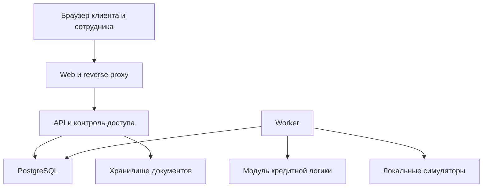
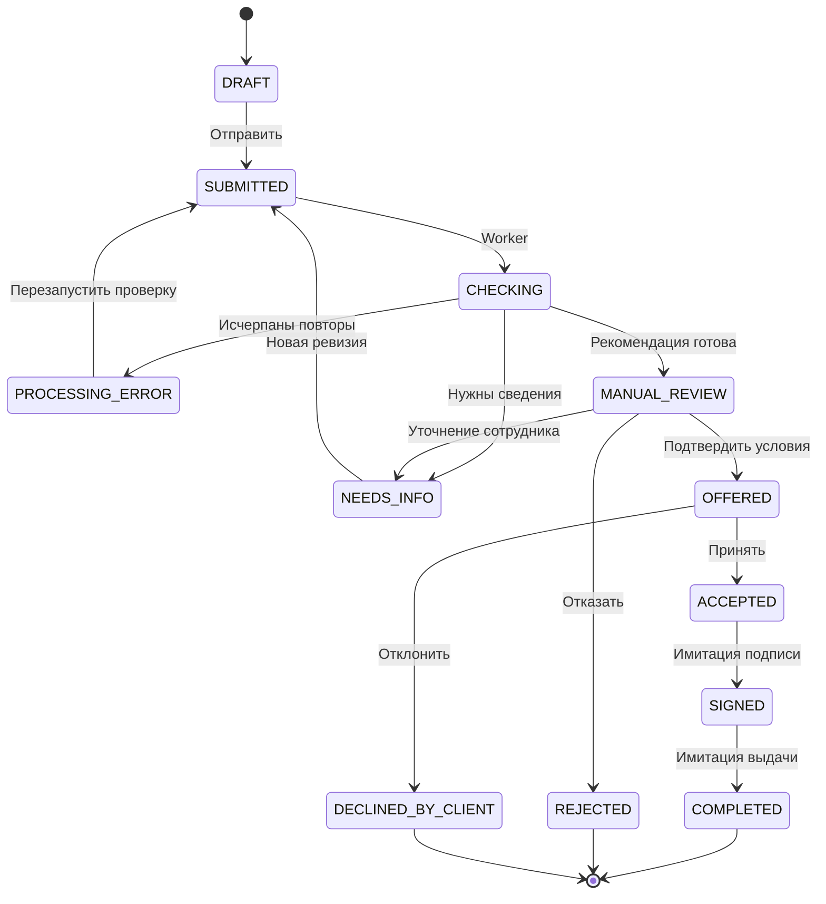
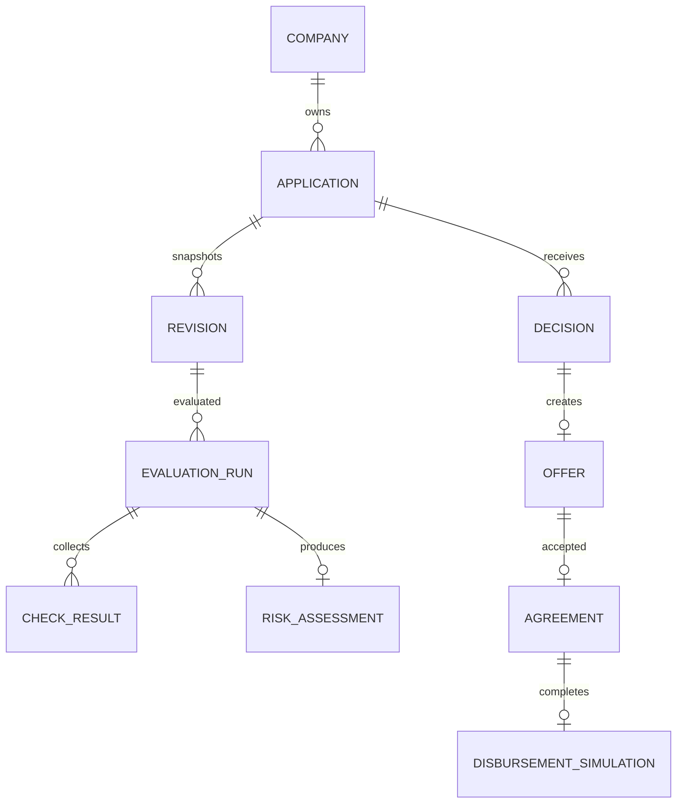

# Архитектура умного кредитного кабинета

Версия спецификации 1.0 от 24 октября 2026 года. Предлагаемая архитектура для реализации командой из пяти человек. Никакой код проекта этим документом ещё не реализован. Статусы, API, схемы и численные правила ниже — проектный контракт для согласования на G0, не банковский стандарт. При расхождении с существующим репозиторием Олег принимает и документирует решение о миграции либо сохранении работающих компонентов.

## 1 Главные решения

| Решение | Причина | Ограничение |
|---|---|---|
| Модульный монолит с отдельным worker | Общие типы, меньше интеграционных ошибок, отдельная обработка длительных задач | Модули пока не масштабируются независимо как сервисы |
| PostgreSQL для данных и очереди jobs | Заявка, событие и задание создаются транзакционно | Не замена специализированному брокеру при большой нагрузке |
| React и TypeScript для одного веб-приложения | Два кабинета, общий UI и адаптивность | Мобильного приложения нет |
| Python и FastAPI для API и risk | Илья может передать чистый Python-модуль; OpenAPI доступна из схем | Версии фиксируются после совместимой сборки |
| Явная rule-based policy | Воспроизводимость и объяснимость без обучающей выборки | Не валидированная модель кредитного риска |
| Человек подтверждает финальный результат | Полный банковский сценарий без усложнения автоматического андеррайтинга | Скорость окончательного решения зависит от сотрудника |
| Симуляторы внешних источников | Выполнение автономности и синтетических данных | Нет реальной проверки юридических лиц и кредитных историй |
| Без LLM в P0 | Нет обязательных платных сервисов и тяжёлых моделей | Объяснения шаблонные, по reason_codes |
| Демо-вход отделён от проверки прав | Простая демонстрация с серверным контролем действий | Открытый demo mode не является защищённой идентификацией личности |

Стек по назначению: React, TypeScript, Vite, один менеджер frontend-зависимостей с lock-файлом; FastAPI, Pydantic, SQLAlchemy, Alembic, psycopg; PostgreSQL; pytest и Playwright. Выбирать точные версии совместно и фиксировать lock-файлами и образами, не смешивать несколько package managers. UI-библиотека одна, локальные ресурсы без CDN. Это минимальный предложенный набор; не добавлять библиотеку без конкретной задачи.

## 2 Компоненты и границы



Стрелки обозначают вызовы и обращения к хранилищам. Кредитная логика — библиотека внутри worker, а не отдельный сетевой сервис. Симуляторы в P0 — локальные адаптеры с контролируемыми задержками/ошибками; отдельный HTTP mock-server не обязателен. И UI, и API доступны через один origin. Только reverse proxy публикует порт; браузер никогда не обращается к БД, worker или симулятору напрямую.

| Модуль | Ответственность | Не делает |
|---|---|---|
| identity | Сессии, пользователи, роль, принадлежность компании | Не принимает роль из пользовательского JSON |
| catalog | Продукты и допустимые параметры | Не вычисляет итоговое решение в браузере |
| applications | Черновики, снимки ревизий, история | Не содержит формулу скоринга |
| workflow | Переходы состояний, команды, транзакции | Не допускает произвольного изменения status |
| integrations | Ответы локальных БКИ/реестра, технические ошибки | Не парсит реальный интернет |
| risk | Признаки, score, policy, offer candidate, причины | Не обращается к сети, БД и API |
| decisions | Решение сотрудника и действующее предложение | Не меняет условия без повторной проверки |
| documents | Загрузка, метаданные, документ предложения, согласие | Не изображает настоящую электронную подпись |
| jobs | Durable обработка, lease, повторы, восстановление | Не гарантирует exactly-once доставку |
| audit | Запись действий и безопасная выдача истории | Не хранит токены и полные документы в логах |

## 3 Структура репозитория

Перечень путей является соглашением владения. Это не утверждение, что перечисленные файлы уже созданы.

| Путь | Содержимое | Основной владелец |
|---|---|---|
| `frontend/src/features/client/` | Клиентские страницы | Игорь |
| `frontend/src/features/bank/` | Банковские страницы | Игорь |
| `frontend/src/api/`, `frontend/src/components/` | Типы, API-клиент, общий UI | Игорь |
| `backend/app/api/`, `backend/app/schemas/` | Endpoint и DTO | Олег |
| `backend/app/identity/`, `applications/`, `workflow/` | Основные домены | Олег |
| `backend/app/risk/` | Чистые функции Ильи | Илья |
| `backend/app/integrations/` | Адаптеры и симуляторы | Олег, схемы Ильи |
| `backend/app/jobs/`, `documents/`, `audit/` | Worker и supporting modules | Олег |
| `backend/migrations/` | Последовательные миграции | Только Олег |
| `backend/tests/` | Unit и integration | Владельцы кода |
| `fixtures/` | Синтетические профили и golden cases | Илья, seed подключает Олег |
| `contracts/` | OpenAPI и примеры запросов/ответов | Олег |
| `tests/e2e/`, `tests/acceptance/` | Независимая приёмка | Рамазан |
| `docs/` | Продукт, архитектура, тесты, demo | По матрице в инструкции |
| `infra/`, `compose.yaml`, `.github/workflows/` | Сборка, proxy, CI | Олег |

В `risk/` не допускаются импорты ORM и FastAPI. `workflow/` может вызывать risk через worker, но не дублирует правила. UI использует API-типы; backend остаётся источником истины для статусов и прав.

## 4 Сценарий и конечные состояния

Клиент выбирает продукт, создаёт черновик и заполняет данные. Submit фиксирует ревизию и задачу. Worker запускает проверки; при недостатке исправимых клиентом данных формируется запрос уточнения, при технической ошибке или неполном ответе источника срабатывают повторы, при завершении расчёта заявка попадает сотруднику. Сотрудник подтверждает предложение или отказывает. Клиент принимает либо отклоняет предложение. Принятие создаёт демонстрационный документ; явное согласие запускает имитацию выдачи.



### Полная таблица команд

| Исходное состояние | Команда и актор | Условие | Следующее состояние |
|---|---|---|---|
| DRAFT | save, клиент-владелец | Структурно корректный patch, поля могут быть неполными | DRAFT |
| DRAFT | submit, клиент-владелец | Все поля и обязательные документы есть, version совпала | SUBMITTED |
| SUBMITTED | start, worker | Job относится к активной ревизии и run | CHECKING |
| CHECKING | require_info, worker | Missing/конфликт существенных сведений | NEEDS_INFO |
| CHECKING | finish, worker | Действующий run получил рекомендацию OFFER либо REJECT | MANUAL_REVIEW |
| CHECKING | processing_failed, worker | Техническая ошибка после лимита повторов | PROCESSING_ERROR |
| PROCESSING_ERROR | retry_checks, сотрудник | Повтор допустим, version совпала | SUBMITTED |
| NEEDS_INFO | save_supplement, клиент-владелец | Только разрешённые поля и документы | NEEDS_INFO |
| NEEDS_INFO | resubmit, клиент-владелец | Уточнения заполнены, создаётся новая revision | SUBMITTED |
| MANUAL_REVIEW | request_info, сотрудник | Непустая причина и список требуемых данных | NEEDS_INFO |
| MANUAL_REVIEW | approve_offer, сотрудник | Ссылается на candidate текущего успешного run с рекомендацией OFFER | OFFERED |
| MANUAL_REVIEW | reject, сотрудник | Есть reason_code и комментарий | REJECTED |
| OFFERED | accept_offer, клиент-владелец | Текущее предложение, правильная version | ACCEPTED |
| OFFERED | decline_offer, клиент-владелец | Текущее предложение | DECLINED_BY_CLIENT |
| ACCEPTED | simulate_sign, клиент-владелец | Подтверждён hash текущего документа и согласие | SIGNED |
| SIGNED | complete_simulation, worker | Уникальная выдача по заявке, document подписан | COMPLETED |

`REJECTED`, `DECLINED_BY_CLIENT`, `COMPLETED` терминальны. Не редактировать такую заявку; можно создать новый черновик копированием разрешённых полей через клиентский UI. В MVP предложение не имеет автоматического срока истечения; это явно описанное упрощение. После OFFERED сотрудник не редактирует условия. Изменение запроса — новая заявка. Сотрудник не может одобрить отрицательную рекомендацию произвольной кнопкой override в P0.

Технический сбой на этапе simulated disbursement оставляет `SIGNED`, а job — в failed/retry, показывает техническое сообщение и доступное сотруднику действие повторить job. Не возвращать в PROCESSING_ERROR кредитных проверок: это другой этап. Повторная подпись не требуется.

### Представление статусов клиенту

| Backend | Текст | Следующее действие |
|---|---|---|
| DRAFT | Черновик | Заполнить и отправить |
| SUBMITTED, CHECKING | Проверяем сведения | Дождаться результата, можно вернуться позже |
| NEEDS_INFO | Нужны дополнительные сведения | Открыть список уточнений |
| MANUAL_REVIEW | Заявка у специалиста | Дождаться решения |
| OFFERED | Предложены условия | Принять или отклонить |
| ACCEPTED | Условия приняты | Ознакомиться с документом |
| SIGNED | Подписание смоделировано | Дождаться имитации выдачи |
| COMPLETED | Выдача смоделирована | Посмотреть результат |
| REJECTED | По заявке принято отрицательное решение | Прочитать объяснение |
| DECLINED_BY_CLIENT | Вы отклонили предложение | При необходимости создать новую заявку |
| PROCESSING_ERROR | Проверка временно недоступна | Заявка сохранена, требуется повтор обработки |

Не обещать точное время ответа сотрудника. Двухминутную цель показывать как измеряемую цель автоматического этапа и только после фактического замера, без ложного таймера одобрения.

## 5 Модель данных

Все идентификаторы UUID, время UTC, суммы NUMERIC с фиксированной точностью. UUID не заменяет проверку доступа. Сырой session token не хранить в БД; хранить его хеш. Для состава данных каждой заявки использовать immutable revision snapshot.

| Таблица | Основные поля | Инварианты |
|---|---|---|
| users | id, username, role, display_name, password_hash, active | CLIENT/OFFICER; username unique; только синтетические аккаунты |
| companies | id, display_name, demo_registration_id, legal_form | Внешняя идентификация в MVP синтетическая |
| memberships | user_id, company_id | Одна компания на клиента в P0; FK и unique |
| sessions | id, token_hash, user_id, csrf_hash, expires_at | Отзыв старой сессии при переключении |
| products | id, code, policy_version, limits_json | Снимок версии правил сохраняется в расчёте |
| applications | id, company_id, creator_id, product_id, status, version, current_revision, active_run_id, draft_json, created_at, updated_at | version увеличивается при каждом изменении бизнес-состояния |
| application_revisions | id, application_id, revision_no, snapshot_json, snapshot_hash, submitted_at | UNIQUE(application_id, revision_no), после submit не меняется |
| documents | id, application_id, revision_no, kind, storage_key, hash, mime, size, created_by | Доступ только через API; новая версия вместо перезаписи |
| evaluation_runs | id, application_id, revision_no, run_no, status, policy_version, model_version, started_at, completed_at | UNIQUE(application_id, revision_no, run_no); active_run_id определяет актуальность |
| integration_checks | id, run_id, source, outcome, payload_json, observed_at, attempt_count | Результат/техническая ошибка различаются |
| risk_assessments | id, run_id, score, band, factors_json, affordability_json, recommendation, reasons_json, candidate_json | Один итог на run; неизменяемый результат |
| info_requests | id, application_id, based_on_run_id, fields_json, document_kinds_json, message, status, actor_id | Один активный запрос; закрывается на resubmit |
| decisions | id, application_id, run_id, type, officer_id, reason_code, comment, created_at | Привязка к ревизии и результату; audit в той же транзакции |
| offers | id, application_id, decision_id, revision_no, terms_json, status | Один действующий офер; terms после создания неизменяемы |
| agreements | id, offer_id, content_hash, storage_key, accepted_at, signed_at, signed_by | Одна версия на принятое предложение; явная метка simulation |
| disbursement_simulations | id, application_id, agreement_id, amount, completed_at | UNIQUE(application_id), никаких реальных платёжных интеграций |
| jobs | id, kind, application_id, run_id, payload_json, state, attempts, available_at, lease_until, lease_token, last_error | Один логический job key, контроль stale lease; run_id nullable для имитации выдачи |
| idempotency_records | actor_id, command_scope, idempotency_key, body_hash, response_status, response_json | UNIQUE(actor_id, command_scope, key) |
| audit_events | id, application_id, actor_id, action, from_status, to_status, revision_no, request_id, metadata, created_at | Добавление без правки через API; не полноценное защищённое audit-хранилище |

Номера демо-компаний использовать вида `DEMO-001`, чтобы не представлять случайный цифровой идентификатор как проверенный реальный ИНН. Поле в UI называется «Демонстрационный идентификатор компании». Поддержка настоящего формата ИНН/ОГРН — отдельно описанный будущий адаптер; кейс не требует реальной регистрации. Если команда решит показывать реалистичный ИНН, обозначить его как синтетический и не обращаться с ним в реальные сервисы.

Основные связи для ER-схемы:



ER-диаграмма показывает ядро, полная таблица выше включает supporting entities. Проверять составные связи: `run.application_id` должен совпадать с `decision.application_id`, offer — с тем же application. Где возможно использовать FK/unique, остальное валидировать транзакционно. Политика хранения документов для MVP — именованный volume без публичной раздачи; для горизонтального масштабирования потребуется объектное хранилище через тот же интерфейс.

## 6 Контракт API v1

Префикс `/api/v1`. JSON UTF-8. Ответы сущностей содержат `id`, `version`, `updated_at`, где применимо. Запросы изменения существующей заявки содержат `expected_version`. Endpoint-операции проверяют version в транзакции. `Idempotency-Key` обязателен для команд submit, resubmit, approve/reject, accept/decline, sign и retry, а также create application. Для PATCH черновика достаточно expected_version. Возвращать согласованный envelope ошибки.

### Endpoint и доступ

| Метод и путь | Доступ | Назначение и важные поля |
|---|---|---|
| GET `/demo/profiles` | demo mode | Только безопасные названия демопрофилей и роли |
| POST `/demo/session` | demo mode | `{profile_id}` → session cookie и csrf token; только allowlist |
| POST `/auth/login` | все | `{username,password}` → session cookie; вход для non-demo тестовых аккаунтов |
| GET `/auth/me` | сессия | user, role, company, csrf token |
| POST `/auth/logout` | сессия + CSRF | Отозвать сессию |
| GET `/products` | сессия | Продукты, границы сумм, сроки и описание |
| POST `/applications` | CLIENT | `{product_code}` → новый DRAFT 201; компания из сессии |
| GET `/applications` | CLIENT | Только свои; cursor/limit |
| GET `/applications/{id}` | владелец | Клиентская проекция и allowed_actions |
| PATCH `/applications/{id}` | владелец | expected_version и разрешённые draft_fields |
| POST `/applications/{id}/documents` | владелец | multipart kind/file/expected_version; DRAFT/NEEDS_INFO |
| GET `/applications/{id}/documents/{doc_id}` | владелец или OFFICER | Проверка связи с заявкой; скачивание |
| POST `/applications/{id}/submit` | владелец | `{expected_version}` → 202 и SUBMITTED |
| GET `/applications/{id}/history` | владелец | Безопасная клиентская история |
| GET `/applications/{id}/info-request` | владелец | Текущий запрос уточнения или null |
| POST `/applications/{id}/resubmit` | владелец | `{expected_version,info_request_id}` → новая ревизия, 202 |
| GET `/applications/{id}/offer` | владелец | Текущее подтверждённое предложение или null |
| POST `/applications/{id}/offer/accept` | владелец | `{expected_version,offer_id}` → ACCEPTED, agreement metadata |
| POST `/applications/{id}/offer/decline` | владелец | `{expected_version,offer_id}` → DECLINED_BY_CLIENT |
| GET `/applications/{id}/agreement` | владелец | Безопасный документ для просмотра и hash |
| POST `/applications/{id}/agreement/simulate-sign` | владелец | `{expected_version,agreement_id,content_hash,consent:true}` → SIGNED, 202 |
| GET `/bank/applications` | OFFICER | Фильтры status/product и pagination |
| GET `/bank/applications/{id}` | OFFICER | Досье, checks, risk, revisions, audit, allowed_actions |
| POST `/bank/applications/{id}/request-info` | OFFICER | expected_version, fields, document_kinds, message |
| POST `/bank/applications/{id}/decision` | OFFICER | expected_version, run_id, type=APPROVE_OFFER/REJECT, candidate_hash при approve, reason_code/comment |
| POST `/bank/applications/{id}/retry-checks` | OFFICER | expected_version; только PROCESSING_ERROR |
| POST `/bank/applications/{id}/retry-disbursement` | OFFICER | expected_version; SIGNED и failed job; один логический эффект |
| GET `/health/live`, GET `/health/ready` | инфраструктура | Liveness процесса; readiness БД/миграций |

Документацию Swagger разместить на `/api/docs`, JSON — `/api/openapi.json`, версии snapshot — в `contracts/openapi.json`. API коллекция должна повторять session/CSRF flow и подставлять актуальные version/run/offer IDs из ответов, а не содержать хардкод UUID.

### Пример черновика

```json
{
  "expected_version": 1,
  "draft_fields": {
    "purpose": "working_capital",
    "requested_amount": "1000000.00",
    "term_months": 12,
    "company_form": "LLC",
    "monthly_revenue": "600000.00",
    "monthly_operating_costs": "400000.00",
    "declared_monthly_debt_payments": "100000.00"
  }
}
```

product_code и purpose должны согласовываться. Название и demo_registration_id компании сервер берёт из профиля; клиент не подменяет company_id. Разрешённая смена продукта только в DRAFT, с очисткой несовместимых полей по явному UI-подтверждению. В NEEDS_INFO можно исправлять только requested_fields активного запроса; смена суммы/продукта/срока требует нового черновика.

### Пример безопасного ответа клиента

```json
{
  "id": "00000000-0000-4000-8000-000000000101",
  "status": "NEEDS_INFO",
  "version": 5,
  "current_revision": 1,
  "next_action": "Уточните ежемесячные платежи по действующим кредитам",
  "allowed_actions": ["SAVE_SUPPLEMENT", "RESUBMIT"],
  "is_simulation": true,
  "updated_at": "2026-10-24T10:00:00Z"
}
```

UUID и время в примере демонстрационные. `allowed_actions` помогает UI, но не заменяет серверную проверку команды. Клиенту не отдавать raw БКИ, внутренние комментарии, технические stack traces и полную risk assessment; банковская схема отделена явно, а не скрыта на frontend.

### Ошибки

```json
{
  "error": {
    "code": "VERSION_CONFLICT",
    "message": "Заявка уже изменилась. Обновите данные перед действием.",
    "field_errors": [],
    "request_id": "req-demo-001"
  }
}
```

401 — сессия отсутствует/истекла; 403 — роль или CSRF не допускает действие; 404 — объект отсутствует или чужой клиентский объект; 409 — версия, состояние или конфликт idempotency key; 413 — файл слишком большой; 415 — неподдерживаемый тип; 422 — поля не проходят валидацию; 429 — частые запросы; 503 — инфраструктурная недоступность. Timeout источника внутри job не становится HTTP 503 для ранее принятого submit: клиент получает сохранённое состояние заявки.

## 7 Risk v1 и демонстрационная политика

Все ставки, суммы, интервалы и пороги в этом разделе вымышлены для прототипа. Они не являются предложением банка, финансовой рекомендацией, калиброванной моделью риска или описанием реальной кредитной политики.

### Вход чистой функции

`evaluate(input: RiskInput, policy: Policy) -> RiskResult` не пишет в БД и не делает сетевые запросы. Олег вызывает её после feature builder. На невалидную структуру — типизированная ошибка контракта, а не кредитный отказ.

```json
{
  "schema_version": "risk-v1",
  "application_id": "00000000-0000-4000-8000-000000000101",
  "revision": 1,
  "product_code": "WORKING_CAPITAL",
  "requested_amount": "1000000.00",
  "term_months": 12,
  "monthly_revenue": "600000.00",
  "monthly_operating_costs": "400000.00",
  "declared_monthly_debt_payments": "100000.00",
  "verified_monthly_debt_payments": "100000.00",
  "company_age_months": 30,
  "registry_status": "ACTIVE",
  "max_overdue_days_12m": 0,
  "required_documents_present": true,
  "sources_complete": true,
  "data_conflicts": [],
  "is_synthetic": true
}
```

Обязательные поля в DRAFT могут отсутствовать; после submit структурно обязательные пользовательские поля заполнены. Во входе risk внешние значения допускают null для missing; ноль означает реальное нулевое значение. `sources_complete=false` означает, что источники не дали необходимых сведений. Worker направляет такой ответ в техническую ветку SOURCE_INCOMPLETE с ограниченными повторами, как timeout; `evaluate` не вызывается. Не просить клиента исправить недоступный ему ответ БКИ. Если risk всё же получил sources_complete=false, он возвращает типизированную техническую ошибку, а не кредитный результат. Snapshot не содержит scenario_id как модельный признак; run сохраняет версию fixtures отдельно для воспроизведения.

### Выход чистой функции

```json
{
  "schema_version": "risk-v1",
  "model_version": "score-v1",
  "policy_version": "policy-v1",
  "risk_score": 100,
  "risk_band": "A",
  "recommendation": "OFFER",
  "requires_officer": true,
  "reason_codes": ["LOWER_AMOUNT_REQUIRED"],
  "requested_fields": [],
  "factors": [
    {"code": "AGE", "points": 25},
    {"code": "MARGIN", "points": 25},
    {"code": "PAYMENT_HISTORY", "points": 30},
    {"code": "EXISTING_DEBT", "points": 20}
  ],
  "candidate": {
    "product_code": "WORKING_CAPITAL",
    "amount": "641000.00",
    "term_months": 12,
    "annual_rate": "0.22",
    "currency": "RUB",
    "fees": "0.00",
    "is_alternative": true
  }
}
```

Пример показывает структуру и ожидаемую альтернативную сумму, окончательные payment/total/dscr заполняет реализация по формулам ниже. Полный `RiskResult` также содержит `affordability` (free_cashflow, existing_payment, requested_payment, requested_dscr, offered_payment, offered_dscr, total_payment), `client_explanations` и `officer_explanations`. Для NEEDS_INFO/REJECT candidate=null. Если score нельзя рассчитать, score/band/factors = null/null/[]; не выдавать 0 вместо «неизвестно». Типы и nullable-поля зафиксировать в схемах до кодирования.

### Продукты

| Параметр | WORKING_CAPITAL | EQUIPMENT |
|---|---|---|
| Цель | Пополнение оборотных средств | Покупка оборудования |
| Сумма | 100 000–3 000 000 ₽ | 300 000–5 000 000 ₽ |
| Шаг суммы | 1000 ₽ | 1000 ₽ |
| Сроки | 6, 12, 18, 24 месяца | 12, 24, 36 месяцев |
| Минимальный возраст | 6 месяцев | 12 месяцев |
| Ставка для A / B | 22% / 26% годовых | 20% / 24% годовых |
| Минимальный DSCR для A / B | 1.25 / 1.40 | 1.25 / 1.40 |
| Документы | FINANCIAL_SUMMARY | FINANCIAL_SUMMARY и EQUIPMENT_QUOTE |

Кредит аннуитетный, комиссии в модели отсутствуют, залог и поручительство не моделируются. Это существенные упрощения. Документ FINANCIAL_SUMMARY подтверждает только наличие загруженного демонстрационного материала: OCR и проверка подлинности не реализованы. Финансовые показатели вводятся структурированно. UI честно разделяет «данные клиента», «данные симулятора» и «содержание документа не проверено».

### Порядок принятия рекомендации

1. Проверить типы, конечность Decimal, диапазоны, соответствие продукта/цели и сроков. Невалидные поля формы — 422 до запуска; повреждённый внутренний контракт — техническая ошибка.
2. При missing исправимых клиентом данных или существенном конфликте вернуть NEEDS_INFO с точным перечнем; `risk_score=null`, если факторов не хватает. Никакого автоматического заполнения пропуска нулём.
3. Проверить стоп-факторы: реестр INACTIVE, возраст меньше минимума, `max_overdue_days_12m > 30`, свободный поток `C <= 0`. При стоп-факторе REJECT с причиной, затем ручное подтверждение сотрудника. Score в этом пути допускается null, чтобы не создавать видимость полноценной оценки.
4. Рассчитать score по таблице; C-band даёт REJECT по демонстрационной политике, A/B идут в расчёт условий.
5. Проверить доступность исходной суммы по DSCR. Если проходит, OFFER на исходных параметрах.
6. Если не проходит, вычислить максимальную сумму на том же сроке. Предложить уменьшенную сумму, только если она не ниже минимума продукта и после округления проходит контрольный расчёт.
7. Если допустимой суммы нет, REJECT с кодом AFFORDABILITY_BELOW_MINIMUM. Не увеличивать срок автоматически и не предлагать фиктивно «гарантированное» одобрение после изменения дохода.

Проверки полноты предшествуют решению по риску, чтобы не принимать окончательное решение на неконсистентном наборе данных. При исправлении и новом run полный порядок выполняется заново. Техническая ошибка не является stop-factor.

### Скоринговая шкала

Сумма баллов от 0 до 100; больший балл соответствует более благоприятному демонстрационному профилю. Score не использует запрошенную сумму: её влияние учитывает policy/доступность. Это упрощает сравнение условий и объясняет, почему одинаковый score не означает одинаковую сумму.

| Фактор | Условие | Баллы |
|---|---|---|
| AGE | возраст >=24 месяцев | 25 |
| AGE | 12 <= возраст <24 | 15 |
| AGE | 6 <= возраст <12 | 5 |
| MARGIN | (R−O)/R >=0.25 | 25 |
| MARGIN | 0.10 <= (R−O)/R <0.25 | 15 |
| MARGIN | 0 < (R−O)/R <0.10 | 5 |
| PAYMENT_HISTORY | max_overdue_days_12m = 0 | 30 |
| PAYMENT_HISTORY | 1–7 дней включительно | 20 |
| PAYMENT_HISTORY | 8–30 дней включительно | 5 |
| EXISTING_DEBT | D/R <=0.20 | 20 |
| EXISTING_DEBT | 0.20 < D/R <=0.40 | 10 |
| EXISTING_DEBT | D/R >0.40 | 0 |

A: score >=80; B: 60 <= score <80; C: score <60. R=monthly_revenue, O=monthly_operating_costs без долговых платежей, D=verified_monthly_debt_payments. R>0, O>=0, D>=0; division-by-zero блокируется валидацией. Возраст ниже 6 и неположительный денежный поток уже остановлены предыдущим этапом. Границы 0.10/0.25/0.20/0.40 проверять без округления промежуточных отношений.

### Доступность и платёж

`C = R − O` — поток до обслуживания долга. `P` — сумма нового кредита, `n` — срок в месяцах, `r = annual_rate / 12`.

`A = P × r / (1 − (1+r)^(-n))` — ежемесячный платёж; при r=0 использовать P/n. Для расчёта денежного графика округлить A до копеек вверх, последним платежом погасить оставшийся долг с процентами. Проценты каждого периода округлять по явно выбранному правилу Decimal ROUND_HALF_UP, затем строить график и total_payment как сумму платежей. Итоговая сумма может отличаться от A×n из-за последнего платежа.

`DSCR = C / (D + A)`; оценка по консервативному округлённому вверх регулярному платежу. Условие `DSCR >= threshold` включительно. Это учебная модель доступности, не полная банковская методология расчёта DSCR.

`A_max = C / threshold − D`. Если A_max<=0, доступной суммы нет. Иначе `P_max = A_max × (1 − (1+r)^(-n)) / r` (при r=0: A_max×n). Взять min(P_requested, product_max, P_max), округлить вниз до 1000 ₽, перепроверить DSCR с фактическим округлённым платежом и при необходимости уменьшить ещё на шаг. Ниже product_min — отказная рекомендация. Срок и ставка определяются запросом и band, а не подгоняются произвольно для одобрения.

Расхождение заявленного D и БКИ считается существенным при `abs(D_declared − D_verified) > max(10000, 0.10 × max(D_verified,1))` рублей. Тогда запросить уточнение declared_monthly_debt_payments. Исправление объясняет расхождение, но не позволяет клиенту перезаписать БКИ. Если клиент оспаривает источник, в P0 сохраняется NEEDS_INFO и сотрудник объясняет ограничение демо; реальный dispute workflow вне объёма.

### Причины и сообщения

| reason_code | Клиент | Сотрудник |
|---|---|---|
| MISSING_DATA | Укажите конкретное недостающее сведение | Поле, источник, missing status |
| DEBT_DATA_MISMATCH | Уточните платежи по действующим кредитам | Заявленное/источник/порог расхождения |
| REGISTRY_INACTIVE | По данным демонстрационного источника статус компании требует отрицательного решения | Статус и версия источника |
| BUSINESS_TOO_YOUNG | В демонстрационной политике этот продукт доступен бизнесу от N месяцев | Фактический возраст и минимум |
| OVERDUE_LIMIT | В демонстрационной проверке выявлена просрочка выше допустимого порога | Дни и threshold |
| RISK_POLICY_LIMIT | Профиль не соответствует правилам этой демонстрационной политики | Факторы, score и band |
| LOWER_AMOUNT_REQUIRED | Предложена меньшая сумма с учётом текущих платежей и доходов | Requested/offered DSCR, A_max и формула |
| AFFORDABILITY_BELOW_MINIMUM | В текущих параметрах расчёт не позволяет предложить минимальную сумму продукта | C, D, A_max, P_max |
| CASHFLOW_NON_POSITIVE | Указанные расходы не оставляют положительного потока для расчёта | R, O, C |

Технические ошибки SOURCE_TIMEOUT, SOURCE_UNAVAILABLE, SOURCE_SCHEMA_ERROR, SOURCE_INCOMPLETE, INTERNAL_ERROR относятся к обработке и не входят в причины кредитного отказа. Клиенту показывается понятное сообщение без инфраструктурных подробностей.

## 8 Golden cases и синтетические данные

Все профили имеют ACTIVE, возраст 30 месяцев, 0 дней просрочки, полные документы и WORKING_CAPITAL на 12 месяцев, если не указано иное. R/O/D в рублях в месяц. DECLARED_D совпадает с D, кроме G03. Продуктовые пределы и другие поля не обходятся профилем.

| ID | R / O / D | Запрос | Изменение | Ожидаемый результат |
|---|---|---|---|---|
| G01 | 1 500 000 / 1 000 000 / 100 000 | 1 000 000 | Нет | Score 100, A, OFFER исходной суммы; далее MANUAL_REVIEW |
| G02 | 600 000 / 400 000 / 100 000 | 1 000 000 | Нет | Score 100, A, OFFER меньшей суммы 641 000 после контрольного расчёта |
| G03 | 600 000 / 400 000 / 100 000 | 1 000 000 | DECLARED_D=0 | NEEDS_INFO; после уточнения до 100 000 — новая revision, как G02 |
| G04 | 1 500 000 / 1 000 000 / 100 000 | 1 000 000 | Просрочка 35 дней | REJECT recommendation, OVERDUE_LIMIT, ручное подтверждение |
| G05 | 300 000 / 260 000 / 30 000 | 100 000 | Нет | Score 90, A; доступная сумма ниже product_min → REJECT recommendation |
| G06 | Как G01 | 1 000 000 | БКИ timeout | Risk не вызывается; retry и PROCESSING_ERROR после исчерпания |
| G07 | 600 000 / 500 000 / 100 000 | 100 000 | Возраст 18, просрочка 5 дней | Score 70, B, 26%; затем проверка доступности, без гарантии OFFER |
| G08 | Как G01 | 1 000 000 | Нет сведений о просрочках при формально успешном ответе | SOURCE_INCOMPLETE: повторы, затем PROCESSING_ERROR, а не ноль дней |

Пример G02 проверен арифметически при подготовке задания: P_max ≈ 641 064.13 ₽, предложенная сумма 641 000 ₽, регулярный платёж 59 994.00 ₽, DSCR ≈ 1.25004688. Точные payment/DSCR и график должна зафиксировать команда в golden JSON с независимым расчётом после реализации правил округления. В acceptance сравнивать суммы с ожидаемыми копейками по принятому алгоритму, отношения — до заранее зафиксированной точности. Не подменять score и outcome в fixtures готовыми ответами для UI: fixtures содержат входные сведения, результат вычисляет risk.

Симулятор хранит связь синтетического demo_registration_id и профиля источника на сервере. Пользователь может менять сумму/срок в допустимых пределах, и ответ должен пересчитываться. Профиль ошибки источника включается только серверной demo-конфигурацией/fixture, не произвольным полем клиентского запроса. Реальное время и random не влияют на итог без управляемого seed/clock.

## 9 Очередь и устойчивость к сбоям

1. Submit в одной транзакции фиксирует revision, status=SUBMITTED, новый run, active_run_id, job и audit event. При rollback не остаётся «заявка отправлена, задания нет».
2. Worker в короткой транзакции выбирает доступную job через `FOR UPDATE SKIP LOCKED`, присваивает уникальный lease_token и lease_until, переводит в running и завершает транзакцию. Во время вызовов источников не держит блокировку БД.
3. Перед запуском проверки валидирует active_run_id и revision. Несовпадение означает obsolete job; она не меняет заявку.
4. Выполняет ограниченные по времени проверки. Рекомендация: timeout 2 секунды на источник, максимум 3 попытки, задержки перед повтором 1 и 3 секунды; все значения конфигурируемы. Для локального mock обычно быстрее. Это настройки прототипа, не SLA банка.
5. При фиксации результата транзакционно проверяет lease_token, active_run_id и допустимый status. Если lease был перевыдан, старый worker не может завершить чужую попытку.
6. Сохраняет check results и risk result, меняет статус, пишет audit и закрывает job атомарно. Уникальные ограничения предотвращают дубли.
7. Истёкший lease возвращается в очередь после проверки лимита попыток. Lease должен быть длиннее bounded обработки; например 60 секунд при указанном коротком сценарии. Для более долгих задач нужен heartbeat/продление.
8. После исчерпания технических повторов CHECKING → PROCESSING_ERROR. Команда сотрудника retry создаёт новый run для той же revision и заменяет active_run_id; старый run сохраняется как failed.
9. После resubmit создаётся новая revision и новый run. Старый job может физически завершиться, но его результаты не становятся актуальными.

Доставка at-least-once с идемпотентными эффектами. Не заявлять exactly-once. Для операции simulate_disbursement UNIQUE(application_id) и транзакционная проверка состояния обеспечивают один бизнес-эффект, даже если job доставлена повторно. PostgreSQL допускает SKIP LOCKED для queue-like tables; использование здесь ограничено claim jobs, а не обычными согласованными чтениями клиентских данных [T2].

## 10 Конкурентность и идемпотентность

`version` — версия изменяемой заявки. `revision` — номер снимка данных при отправке. `run_id` — конкретный запуск проверок. Они решают разные задачи, их нельзя объединять в одно поле.

Для команды сначала проверить текущую сессию и доступ к объекту, затем запись idempotency по actor + method/path scope + key. Если body_hash тот же, вернуть ранее зафиксированный ответ без повторной проверки старого expected_version; иначе 409 IDEMPOTENCY_CONFLICT. Для нового key выполнить проверку expected_version и состояния, записать результат и idempotency record в общей транзакции. Если первый запрос ещё in-flight, второй получает документированный 409 REQUEST_IN_PROGRESS и может повторить тот же key. Не возвращать ранее сохранённый ответ другой сессии без проверки доступа.

Два сотрудника видят version=10. Первый принимает решение и делает version=11. Второй получает 409, после reload видит новое состояние. UI не должен автоматически подтвердить его действие на новой версии.

Хранить idempotency-записи в течение жизни демонстрационного набора, не удалять по короткому TTL во время показа. Hash тела вычислять по каноническому JSON; в scope включать application_id и имя команды. Для файлов связывать команду с хешем содержимого, если вводится retry-upload в дальнейшем.

## 11 Безопасность и честные ограничения

### Демо и обычный вход

DEMO_MODE=true разрешает выбор заранее созданного профиля и явно показывает баннер. Это осознанно открытый стенд с синтетическими данными: посетитель может выбрать роль сотрудника. RBAC демонстрирует ограничения выбранной сессии, но не доказывает идентификацию реального сотрудника. При DEMO_MODE=false `/demo/*` недоступны, используются тестовые credentials из инструкции, хешированные пароли и обычная серверная сессия. Производственная идентификация через корпоративный IdP — будущая интеграция.

Рекомендуется opaque session token в HttpOnly cookie, SameSite=Lax, с ограниченным сроком; Secure обязателен на HTTPS-стенде. В локальном HTTP Secure выключается только явной local-конфигурацией. Session rotation при входе и выборе нового профиля, отзыв при logout. CSRF-токен на изменения, Origin проверка и запрет произвольного credentialed CORS. Login/demo-session защищать Origin-проверкой и ограничением частоты, чтобы не вводить пользователя в навязанную сессию.

### Права и документы

Каждый endpoint проверяет роль и принадлежность объекта, включая скачивание файла. Разрешения по умолчанию запрещены; UUID и скрытые кнопки не являются защитой [T3]. Клиент не может передавать `role`, `score`, `status`, `company_id` и `annual_rate` через mass assignment. Неизвестные поля изменяющих DTO отвергать. Банковский DTO доступен только OFFICER.

Файлы: PDF/PNG/JPEG, максимум 10 MiB на файл и 5 файлов на заявку в P0. Проверять расширение, заявленный MIME и сигнатуру; имя хранения генерируется сервером. Не принимать HTML/SVG/архивы и не исполнять содержимое. Не раздавать каталог upload как static. Документы выдавать как attachment либо безопасный просмотр по API с Content-Type и nosniff; PDF viewer не должен открывать произвольный пользовательский HTML. Антивирус и полноценная проверка вредоносного содержимого отсутствуют — это ограничение прототипа, а не обещание безопасности загрузок.

Секреты только в окружении, `.env` исключён из Git, `.env.example` без реальных секретов. Пароли БД не передаются frontend. В логах только идентификаторы и коды, без сессий/паролей/содержимого документов. Audit append-only на уровне приложения, но администратор БД технически может изменить записи; не называть его юридически неизменяемым журналом.

Cloud-native здесь означает контейнеризацию, конфигурацию через окружение, отделённое хранилище состояния, health checks и управляемый процесс worker. Наличие Docker не делает приложение автоматически enterprise-ready. Высокая доступность БД, KMS, централизованный мониторинг, резервное копирование, real IAM и юридическая проверка — будущие работы.

## 12 Запуск и окружение

Целевая команда README: `docker compose up --build -d`. Репозиторий должен предоставлять рабочие локальные demo defaults без платных ключей. Первая сборка может требовать интернет для открытых пакетов и образов; автономность основного пользовательского сценария проверяется после сборки. Для полностью offline установки понадобится заранее подготовленный image archive и отдельная инструкция; кейс не требует обещать offline download.

Compose: db → init migrations+idempotent seed → api и worker → web. `depends_on` используется с health/completion условиями, а приложение также обрабатывает временную недоступность БД. Обычный restart не запускает destructive reset. Dockerfiles выполняют приложение от непривилегированного пользователя там, где это поддерживается конфигурацией.

| Переменная | Назначение | Правило |
|---|---|---|
| APP_ENV | local/demo/production | Не маскировать demo под production |
| DEMO_MODE | Демо-профили | По умолчанию локальный demo; выключить в production |
| DATABASE_URL | Соединение PostgreSQL | Только backend/worker/init |
| SESSION_SECRET | Подпись вспомогательных токенов, если используется | Для настоящего окружения не default |
| SESSION_TTL_SECONDS | Срок сессии | Единый серверный параметр |
| COOKIE_SECURE | Только HTTPS-cookie | true для публичного HTTPS |
| ALLOWED_ORIGINS | Контроль origin | Конкретные origin, без wildcard с credentials |
| DOCUMENTS_DIR | Путь к volume документов | Не публичная директория web |
| POLICY_VERSION | Активная policy | Записывается в run, не перезаписывает историю |
| INTEGRATION_MODE | mock | P0 не требует иных режимов |
| CHECK_TIMEOUT_SECONDS | Таймаут источника | Ограничен и протестирован |
| JOB_MAX_ATTEMPTS | Число попыток | Конечное; пример 3 |
| JOB_LEASE_SECONDS | Lease worker | Больше максимальной bounded обработки |
| LOG_LEVEL | Логи | Не включать sensitive debug на демо |

CPU/RAM не обещать без замера. Цель — обычный ноутбук без GPU. Олег фиксирует фактическое потребление и время старта в README. Reverse proxy обслуживает собранный frontend и `/api`; api/worker не используют dev reload в демонстрационном запуске. PostgreSQL volume и documents volume переживают down/up без `-v`.

## 13 Качество и наблюдаемость

Целевые показатели для проверки, а не результаты уже выполненных тестов:

- Полный E01 проходит на свежем окружении без ручного SQL и ключей облачных сервисов.
- Все E01–E16 выполнены; blocker/critical отсутствуют перед сдачей.
- Детерминированные golden cases воспроизводятся на закреплённой policy.
- Все изменяющие команды проверяют роль/владельца/version; повтор не дублирует эффект.
- Автоматическая обработка обычного локального сценария укладывается в целевой бюджет 120 секунд; фактическое p50/p95 считать минимум на 30 прогонах и указывать оборудование. Не включать ожидание сотрудника в этот показатель.
- Нет runtime вызовов сторонних API; исходящие сетевые запросы можно блокировать после сборки.
- После kill worker незавершённая job возобновляется в пределах lease + polling interval, при доступной БД. Измерить фактически.

Собирать: submit_at, checks_started_at, checks_completed_at, officer_opened_at, decision_at, accepted_at, completed_at. Для времени сотрудника учитывать начало активного рассмотрения, а не всю очередь; автоматический сбор не заменяет наблюдение за экспериментом. Метрики по синтетическим заявкам не экстраполировать на реальный портфель.

Структурированные логи: timestamp, level, event_code, request_id, application_id, run_id, job_id, attempt, duration_ms. Ошибки содержат machine code; подробный stack trace доступен только в серверном диагностическом логе. Health endpoint не раскрывает credentials и структуру сети.

## 14 Контроль контрактов и выпуск

G0 замораживает status enum, risk-v1, API v1 и policy-v1. Изменение до релиза оформляется PR с миграцией/обновлением схем, fixtures, frontend типов, тестов и документации. Breaking change без обновления потребителей не сливать.

CI: lint/typecheck → unit → PostgreSQL integration → web build → Compose smoke/E2E → проверка артефактов. OpenAPI snapshot сравнивается с генерируемым, чтобы незаметно не разошлись frontend и backend. Конкретные команды выбирает команда и фиксирует в README; этот документ не утверждает, что pipeline уже работает.

Перед сдачей: clean clone, успешный запуск, демонстрационный сценарий, тестовый отчёт, проверенные сторонние лицензии, конечный hash и tag. Коммиты после дедлайна не входят в сдаваемый результат. При private репозитории предоставить аккаунту `alfa-hack-2026` доступ. Публичная ссылка на стенд — дополнение к репозиторию и Docker, не замена.

## 15 Развитие после работающего MVP

1. Реальный Identity Provider и корпоративные роли; никаких общедоступных переключателей пользователей.
2. Реальные источники через уже определённые adapters с согласиями, договорным доступом и требованиями к данным.
3. Валидированная кредитная модель на допустимой выборке, калибровка, мониторинг качества и смещений. Синтетические тесты остаются проверкой кода.
4. Автоматические решения в узком сегменте только после обоснования политики и контроля качества. В P0 все финальные решения ручные.
5. Объектное хранилище и несколько worker; при реальной нагрузке специализированная очередь, HA БД, backup/restore и централизованный audit.
6. OCR/LLM с открытыми весами для извлечения и пояснений, с верификацией извлечённых полей пользователем. Отказ модели не блокирует основной путь, LLM не является автором финального решения.

## 16 Основания решений

Бизнес-требования: исходный PDF, стр. 6–15. Назначения участников и исходные идеи: расшифровка созвона 00:00–14:54. Предлагаемые технические решения и численные правила — авторский проектный план; они не являются требованиями организаторов, если это отдельно не указано.

Проверенные технические первоисточники, просмотрены 24 октября 2026 года:

- [T1 FastAPI in Containers](https://fastapi.tiangolo.com/deployment/docker/) — основы упаковки FastAPI в контейнеры; конкретная Compose-топология выше выбрана для проекта.
- [T2 PostgreSQL SELECT](https://www.postgresql.org/docs/current/sql-select.html) — row locking и применение SKIP LOCKED к queue-like tables; lease и job-протокол выше являются нашей реализационной схемой.
- [T3 OWASP Authorization Cheat Sheet](https://cheatsheetseries.owasp.org/cheatsheets/Authorization_Cheat_Sheet.html) — запрет по умолчанию и проверка доступа к каждому запросу/объекту; не сертификат безопасности проекта.
