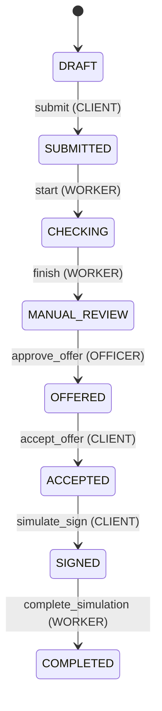
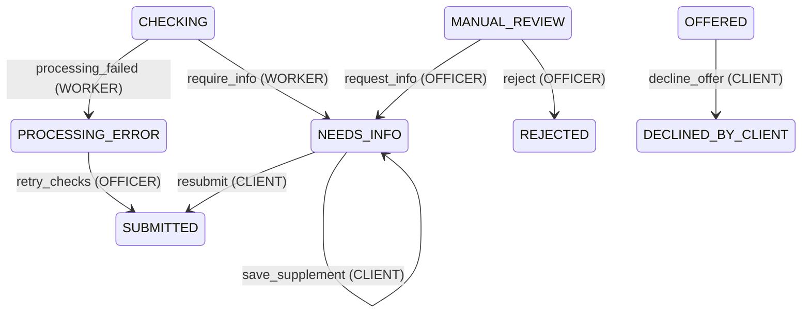

# State machine заявки (B11)

Источник истины: [`contracts/statuses.json`](../contracts/statuses.json).  
Код: `backend/app/workflow/transitions.py`, enum `backend/app/schemas/enums.py`.

Терминальные: `COMPLETED`, `REJECTED`, `DECLINED_BY_CLIENT`.

## Основной путь

## Ветки

## Правила

- Статус меняется **только** разрешённой командой и актором; произвольный PATCH status запрещён.  
- Сбой имитации выдачи **оставляет** `SIGNED` (не `PROCESSING_ERROR`); officer — `RETRY_DISBURSEMENT`.  
- Клиентские подписи и выдача — **симуляция** (`is_simulation`).
